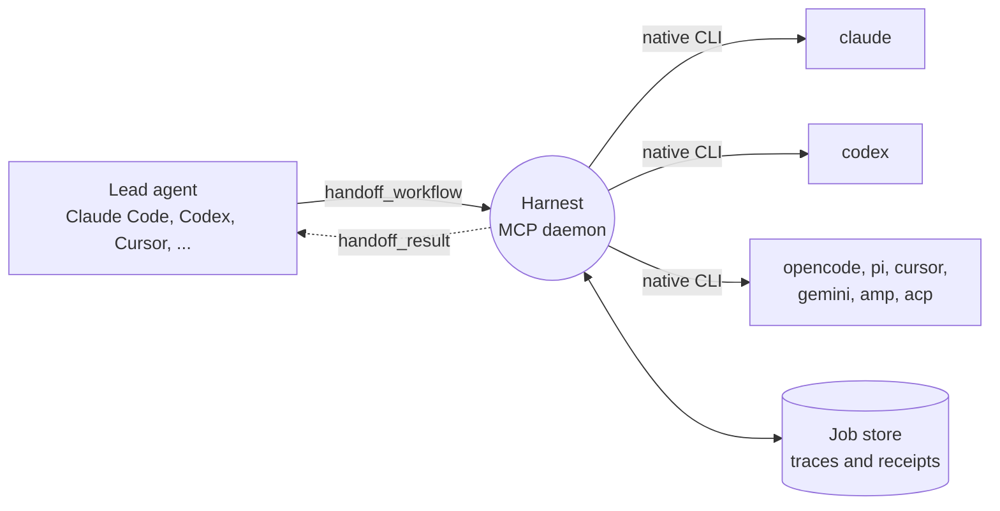
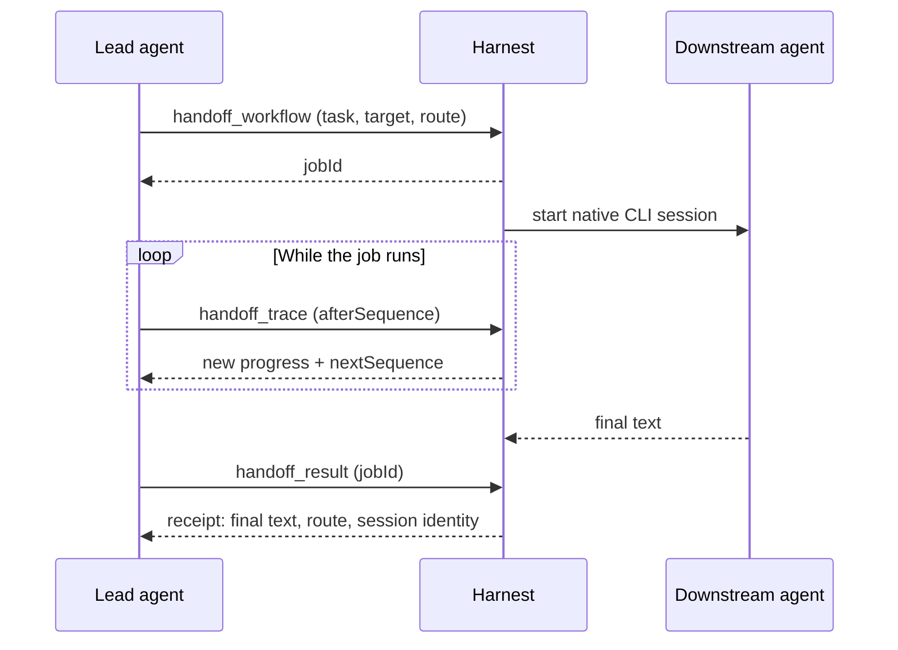
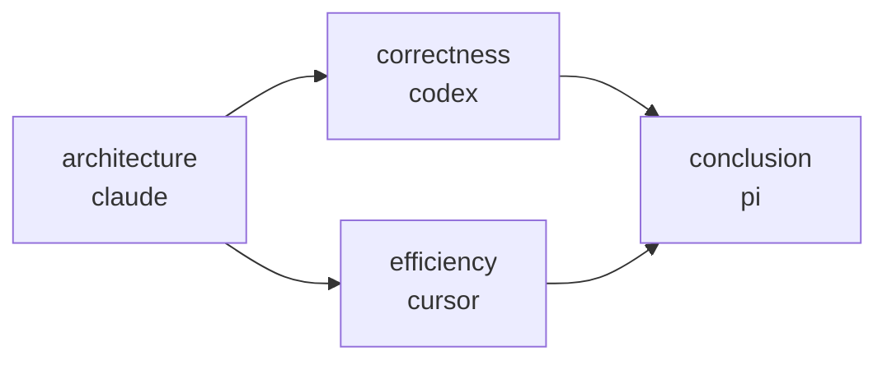

# Harnest

<p align="center">
  <strong>Let one coding agent hand work to another, and get a receipt back.</strong>
</p>

<p align="center">
  <a href="https://github.com/harshanandak/harnest/actions/workflows/ci.yml"></a>
  <a href="https://github.com/harshanandak/harnest/releases"></a>
  <a href="LICENSE"></a>
  
  
</p>

<p align="center">
  <a href="#quick-start">Quick start</a> ·
  <a href="#your-first-handoff">First handoff</a> ·
  <a href="#supported-clients-and-downstream-agents">Supported agents</a> ·
  <a href="#documentation-index">Docs</a> ·
  <a href="CHANGELOG.md">Changelog</a>
</p>

---

Harnest is an MCP server that gives your lead coding agent **durable handoffs** to other native coding agents. The lead picks which agent runs a task, follows its progress, and collects a validated receipt with the final answer, route, and session identity. It can also run **dependency graphs** across several agents, such as parallel reviews followed by a synthesis.

- **Durable.** Jobs are saved to disk and keep running if the caller or MCP server exits. Recover any handoff by job ID or request ID.
- **Native.** Each downstream agent runs its own CLI with its own login. Harnest never forwards lead credentials.
- **Honest receipts.** Transport errors, downstream failures, partial results, cancellations, and success stay distinct.
- **No model turns for scheduling.** Graphs resolve routes before dispatch and pass each node only its direct dependencies.



## Quick start

You need **Git**, **Bun**, and **Node.js 22.19 or newer** (for the default install with optional Taskflow packages). Install and log in to each downstream CLI through its own setup first, and keep those CLIs on `PATH`.

**1. Clone and install.** Pick a directory you will keep, because host configs point at it.

```sh
git clone https://github.com/harshanandak/harnest.git
cd harnest
bun install --frozen-lockfile
```

**2. Connect your lead agent.** This example uses Codex. Pick your own host below.

```sh
bun run setup codex
bun run doctor --host codex
```

**3. Restart the lead agent** and check that it lists `handoff_workflow`, `handoff_status`, `handoff_trace`, and `handoff_result`. Then run [your first handoff](#your-first-handoff).

> [!TIP]
> Run `bun run setup --help` to see every host name. Setup also installs the shared daemon and a login item so it starts with your machine. Pass `--no-autostart` to skip that.

### Pick your lead agent

<details>
<summary><b>Claude Code</b></summary>

```sh
bun run setup claude
```

Installs the local marketplace and the Harnest plugin. Add `--project "/absolute/path/to/project"` to migrate old workspace registrations. Restart Claude Code. See [Claude Code setup](docs/users/integrations.md#claude-code).
</details>

<details>
<summary><b>Codex</b></summary>

```sh
bun run setup codex
```

Installs the plugin, the user MCP bridge, and native workers. Restart Codex and invoke the skill as `$handoff`. See [Codex setup](docs/users/integrations.md#codex).
</details>

<details>
<summary><b>OpenCode</b></summary>

```sh
bun run setup opencode
```

Installs the MCP entry, plugin, worker agents, skill, and commands. Save the reverse command it prints. See [OpenCode setup](docs/users/integrations.md#opencode).
</details>

<details>
<summary><b>Pi</b></summary>

```sh
bun run setup pi
```

Installs the native extension, its settings entry, and the handoff skill. Start a new Pi session afterwards. See [Pi setup](docs/users/integrations.md#pi).
</details>

<details>
<summary><b>Cursor</b></summary>

```sh
bun run setup cursor --project "/absolute/path/to/project"
```

Installs the user MCP bridge plus the project's skill, router rule, worker, and commands. Restart Cursor. See [Cursor setup](docs/users/integrations.md#cursor).
</details>

<details>
<summary><b>Gemini CLI (legacy) or Amp</b></summary>

```sh
bun run setup gemini
bun run setup amp
```

Gemini gets the bridge with `trust: false`. Check it with `/mcp list`. If Amp reports `awaiting approval`, run `amp mcp approve harnest`. See [Gemini CLI](docs/users/integrations.md#gemini-cli-as-a-lead-client) and [Amp](docs/users/integrations.md#amp-as-a-lead-client).
</details>

<details>
<summary><b>GitHub Copilot CLI, Qwen Code, Kilo, Cline, Kiro, Factory Droid, Auggie, Kimi, Devin</b></summary>

```sh
bun run setup github-copilot-cli   # or qwen-code, kilo, cline, kiro, factory-droid, auggie, kimi, devin
```

Setup installs the MCP bridge into that host's config. For Goose and Mistral Vibe, `bun run setup goose` and `bun run setup mistral-vibe` print the config to add by hand.

> [!NOTE]
> These preset setups are covered by CI fixtures only. They have not been tested against the live CLIs. See the [preset lead host instructions](docs/users/integrations.md#acp-presets-as-lead-clients).
</details>

<details>
<summary><b>Any other MCP client</b></summary>

```sh
bun run setup other
```

Prints a stdio bridge snippet to paste into your client. For a direct HTTP connection, see [the HTTP setup instructions](docs/users/getting-started.md#add-the-mcp-server) and [choose a connection](#choose-a-connection).
</details>

To disconnect, run `bun run setup remove <host>` for an automatic preset, Gemini CLI, Amp, or Cursor's user config. Use the same config path overrides as setup. It backs up the file before it removes the Harnest entry. See [removing a registration](docs/users/integrations.md#remove-an-mcp-registration).

## Your first handoff

With Codex installed and logged in as the downstream agent, call `handoff_workflow` with this input. Set `cwd` to the absolute path of a Git checkout.

```json
{
  "request": {
    "requestId": "first-read-001",
    "target": "codex",
    "task": "Summarize how tests are organized in this repository. Include file paths.",
    "cwd": "/absolute/path/to/project",
    "execution": { "background": true },
    "policy": { "write": false }
  }
}
```

Then follow the job through to its receipt:



| Step | Tool | What to pass |
| --- | --- | --- |
| Check state | `handoff_status` | the returned `jobId` |
| Stream progress | `handoff_trace` | `jobId`, plus the last `nextSequence` as `afterSequence` |
| Get the receipt | `handoff_result` | `jobId`, after the job settles |
| Stop it | `handoff_cancel` | `{ "jobId": "<returned job ID>" }`, then poll status |

See [tool inputs and examples](docs/users/mcp-usage.md) for every field.

### Workflows and graphs

| You want to | Use |
| --- | --- |
| Run one bounded task you can recover later | A single background handoff |
| Run parallel reviews, then combine them | [A dependency graph](examples/agent-graph.json) ([contract](docs/agent-graphs.md)) |
| Decide loops, branches, or fan-out at runtime | [A JavaScript workflow](docs/javascript-workflows.md) |

The [example graph](examples/agent-graph.json) reviews a plan with four agents:



Each node receives results only from its direct dependencies. A retry keeps nodes that already succeeded.

## Supported clients and downstream agents

A **lead client** connects to Harnest through MCP. A **downstream agent** runs the task with its own native login. Direct MCP use needs only the connection and the downstream CLI.

| Agent or client | Lead connection | Downstream target and limits |
| --- | --- | --- |
| Claude Code | Daemon HTTP via the plugin's header helper | `claude` supports read and approved write, session resume, and live controls on session transport. |
| Codex | Stdio bridge via the host installer | `codex` supports read-only and approved workspace-write, session resume, and live controls on session transport. Native Windows Codex setup has an upstream payload limit; see [release limits](docs/users/limits.md). |
| OpenCode | Daemon HTTP via the integration installer | `opencode` requires OpenCode V2. It supports approved write-capable prompt handoffs, optional Taskflow, and server-attached live controls. |
| Pi | Daemon HTTP via the extension | `pi` supports read and approved write, optional Taskflow, and live steer and reroute. |
| Cursor | Stdio bridge via the integration installer | `cursor` supports read and approved write, session resume, and optional session transport. UI subagents need their own MCP registration. |
| Gemini CLI (legacy) | MCP configuration | `gemini` requires CLI v0.62.0. Read and approved write are available with native-session follow-up. Inherited include directories limit filesystem containment. |
| Amp | MCP configuration | `amp` supports approved write only, with native-session follow-up. Run Harnest on Linux, macOS, or inside WSL. |
| Antigravity CLI | [Manual MCP configuration](docs/users/integrations.md#antigravity-cli-as-a-lead-client) | `acp` with `route.agent: "antigravity"` launches `agy acp` for approved writes. Harnest has not verified the preset against the real CLI. |
| Registered ACP agent | Depends on the client's MCP support | `acp` supports approved writes with an explicitly trusted local registration. Register with `bun run acp add <preset-id> --trust` or [supply your own command](docs/acp-agents.md#register-manually). Harnest has not verified the twelve presets against the real agents. |

Gemini CLI now serves only paid Gemini API keys and enterprise Code Assist. Personal Google accounts should use the `antigravity` ACP preset. See [Development and account changes for Gemini CLI](https://github.com/google-gemini/gemini-cli/discussions/27274).

Gemini, Amp, and generic ACP use native-session follow-up and reject session transport and live controls. See [supported agents](docs/users/supported-agents.md) for the full control and platform boundaries.

## Choose a connection

<details>
<summary><b>Shared daemon over HTTP</b> (default for Claude Code, OpenCode, Pi)</summary>

Use `http://127.0.0.1:41237/mcp` with the daemon's local bearer credential. The [HTTP setup instructions](docs/users/getting-started.md#add-the-mcp-server) show how to write the header into a private client config. URL-only clients need a running daemon; start one by hand with `bun run daemon start`.
</details>

<details>
<summary><b>Stdio bridge</b> (for clients that require stdio)</summary>

Configure `node /absolute/path/to/harnest/src/mcp-bridge.mjs`. The bridge starts the daemon on demand and forwards requests to it.
</details>

<details>
<summary><b>Standalone stdio</b> (one runtime per invocation)</summary>

Configure `node /absolute/path/to/harnest/src/mcp-server.mjs` to give each invocation its own runtime.
</details>

Host installers register a login item by default: Windows Task Scheduler, a macOS LaunchAgent, or a systemd user unit. Run the installer with your `HARNEST_STATE_DIR` (if you set one) and the downstream CLIs on `PATH`. The login item captures `PATH`, the job and daemon directories, and supported non-secret Harnest settings. See [daemon lifecycle](docs/architecture.md#shared-daemon) and [host setup and restore](docs/users/integrations.md).

## Choosing models

Tell your lead agent which model to use in plain words. For example, “Use gpt-6.1-sol at high effort for this review.”

You can also [set routing preferences once](docs/preferences.md#set-up-from-the-terminal). The lead uses your saved choice when you leave the model out of your prompt. If neither applies, the downstream CLI uses its own configured default.

Call `handoff_routing_preview` to see the chosen route before dispatch.

## Safety, data, and limits

> [!IMPORTANT]
> Approve write scope before dispatch. Requests, task context, traces, receipts, and downstream output can be stored locally as plaintext. Keep credentials out of handoffs and protect the state directory.

- Generic ACP trust lets the registered executable load its native configuration and extensions.
- The daemon binds to loopback. Its private `token` file lives under `%LOCALAPPDATA%/harnest/daemon/` on Windows, `~/Library/Application Support/harnest/daemon/` on macOS, and `$XDG_STATE_HOME/harnest/daemon/` on Linux (default `~/.local/state/harnest/daemon/`). With `HARNEST_STATE_DIR` set, `daemon/` sits next to the jobs directory. Host settings and installer backups may contain the local credential, so keep them private.
- CI host-installation fixtures cover configuration and reversal. Live host installation and authenticated downstream coverage vary. See the [release limits](docs/users/limits.md) for the verification boundary, unsupported controls, and platform constraints.

## Update or remove

<details>
<summary><b>Update or roll back</b></summary>

Fetch tags, check out the release tag you want, run `bun install --frozen-lockfile`, rerun the integration installer, and restart the host. Keep the installer backups. To roll back, repeat with the previous tag, or follow the [host restore instructions](docs/users/integrations.md) for configuration changes.
</details>

<details>
<summary><b>Remove the daemon login item</b></summary>

Run these from the checkout with the same state settings you used at install. If stop reports `busy`, wait for active work to finish and run stop again before removing autostart.

```sh
bun run daemon stop
bun run daemon uninstall-autostart
```

Run uninstall as the installing user. On Linux, use the same `XDG_CONFIG_HOME` if you customized it. This keeps durable jobs and host configurations. To disconnect a host, remove its Harnest MCP entry or restore its installer backup, then restart it.
</details>

## Documentation index

| Topic | Read |
| --- | --- |
| Install and connect | [Getting started](docs/users/getting-started.md), [host integrations](docs/users/integrations.md), [troubleshooting](docs/users/troubleshooting.md) |
| Use the tools | [MCP tool inputs](docs/users/mcp-usage.md), [agent graphs](docs/agent-graphs.md), [JavaScript workflows](docs/javascript-workflows.md) |
| Tune behavior | [Routing preferences](docs/preferences.md), [live transcript behavior](docs/live-transcript.md), [registered ACP agents](docs/acp-agents.md) |
| Internals | [Architecture](docs/architecture.md), [adapter contract](docs/adapter-contract.md) |

## Development and releases

GitHub CI runs the Node test suite through `bun run check`, then `bun run smoke:mcp`, `bun run validate:plugin`, and the memory gates. When you edit worker definitions, update `scripts/build-workers.mjs` and regenerate the checked-in files with `node scripts/build-workers.mjs`.

See the [changelog](CHANGELOG.md) and [release process](RELEASING.md) for the GitHub source releases.

## Support, security, and license

Report installation and usage problems in [GitHub Issues](https://github.com/harshanandak/harnest/issues) with the tag, host, downstream CLI, OS, and sanitized reproduction details. Follow the [security policy](SECURITY.md) for sensitive reports. Harnest is licensed under the [MIT License](LICENSE).
